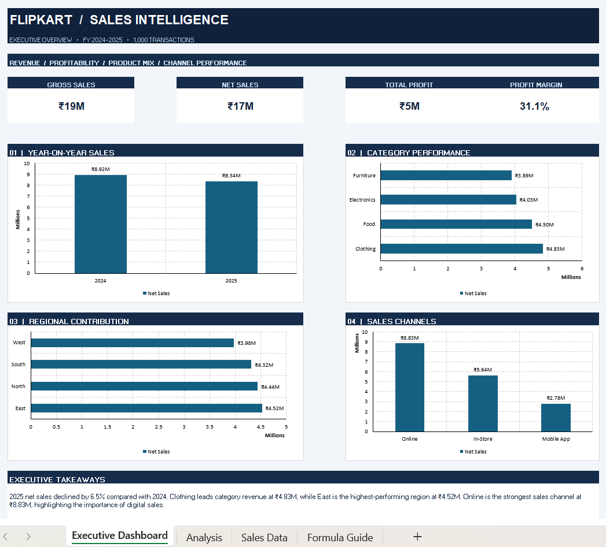

# Flipkart Sales Intelligence Dashboard

### Excel | Sales Analytics | Business Intelligence

An interactive-style sales analytics dashboard built using Microsoft Excel to analyze sales performance, profitability, product categories, regional contributions, and sales channels across FY 2024–2025.

## Dashboard Preview

## Key Performance Indicators

| Metric | Value |
|---|---|
| Gross Sales | ₹19M |
| Net Sales | ₹17M |
| Total Profit | ₹5M |
| Profit Margin | 31.1% |
| Total Transactions | 1,000 |

## Key Business Insights

- Net sales declined by approximately 6.5% in 2025 compared with 2024.
- Clothing was the leading category, generating ₹4.83M in sales.
- The East region contributed the highest sales at ₹4.52M.
- Online was the strongest sales channel, contributing ₹8.83M.

## Dashboard Features

- Year-on-year sales comparison
- Category-wise sales performance
- Regional sales contribution
- Sales channel analysis
- Executive KPI summary
- Business insights and performance interpretation

## Tools and Skills

- Microsoft Excel
- Excel formulas and calculations
- Data analysis and aggregation
- KPI development
- Data visualization
- Dashboard design
- Business reporting

## Workbook Structure

- **Executive Dashboard:** KPI cards, charts, and business insights
- **Analysis:** Supporting calculations and summaries
- **Sales Data:** Transaction-level dataset
- **Formula Guide:** Documentation of calculations

## Project Objective

To transform transaction-level sales data into a clear executive dashboard that supports data-driven business decisions.

## Author

**Ditya Gupta**

[GitHub](https://github.com/ditya0101gupta-svg) | [LinkedIn](https://www.linkedin.com/in/ditya-gupta-506220193/) | [Portfolio](https://ditya0101gupta-svg.github.io/data-analytics-portfolio/)
